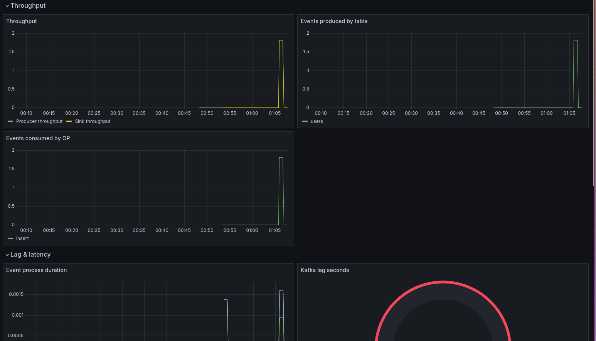
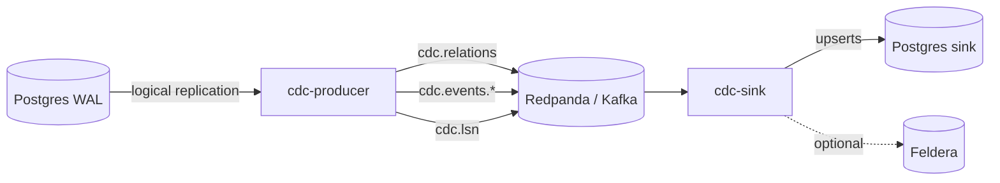

# CDC Connector

[](https://github.com/sheosi/cdc-connector/actions/workflows/ci.yml)
[](https://www.rust-lang.org)
[](#license)

Postgres → Kafka CDC pipeline built in Rust. Decodes logical replication WAL, shares schemas via a compacted Kafka topic, and writes events to per-table topics. Includes both a Postgres sink and a Feldera sink.



## What this project demonstrates

- Logical replication decoding with a custom WAL reader.
- Schema-on-wire: table schemas are encoded as Avro and published to a compacted topic.
- Exactly-once semantics via Kafka transactions + idempotent writes.
- LSN checkpointing for crash recovery.
- Fast parsing with zero-copy, arena-backed decoding (~135 ns per insert).
- End-to-end integration tests using Testcontainers and Redpanda.
- Observability with Prometheus metrics and a provisioned Grafana dashboard.

## Architecture



## Supported Postgres types and messages

| Data types | WAL messages |
|------------|--------------|
| `int4`, `int8`, `text`, `bool`, `timestamp` | `INSERT`, `UPDATE`, `DELETE`, `BEGIN`, `COMMIT` |

## Quick start

```bash
docker compose up -d
```

This starts:
* Postgres source and sink databases
* Redpanda
* `cdc-producer` and `postgres-connector`
* Prometheus and Grafana with a pre-loaded CDC dashboard

Open:
* Grafana: http://localhost:3000/d/dg18rqz7euhvkc/cdc-dashboard (admin / admin)
* Prometheus: http://localhost:9090
* Redpanda Console: http://localhost:8079
* Feldera: http://localthost:8081

## Configuration

### cdc-producer

Also, checkout `config/cdc-producer.toml`

| Var | Default | Description |
|-----|---------|-------------|
| `CDC_PROD_WILL_CONNECT_TO_FELDERA` | `false` | Whether the `feldera-connector` is going to be used |
| `CDC_PROD_POSTGRES_HOST` | None | source DB host|
| `CDC_PROD_POSTGRES_USER` | None | Source DB user |
| `CDC_PROD_POSTGRES_PASSWORD` | None | Source DB password |
| `CDC_PROD_POSTGRES_SLOTNAME` | None | Source DB slot name |
| `CDC_PROD_POSTGRES_DBNAME` | None | Source DB name to connect to |
| `CDC_PROD_POSTGRES_PUBLICATION` | None | Source DB publication name |
| `CDC_PROD_POSTGRES_PORT` | `5432` | Source DB port |
| `CDC_PROD_KAFKA_BROKERS` | None | Kafka brokers host and port |
| `CDC_PROD_KAFKA_TOPIC` | `cdc` | Parent topic where to put all the events, relations and lsn |
| `CDC_PROD_KAFKA_KEY` | None | The key to use in kafka |
| `CDC_PROD_METRICS_PORT` | `9000` | Metrics HTTP port |

### postgres-connector

Also, checkout `config/postgres-connector.toml`

| Var | Default | Description |
|-----|---------|-------------|
| `PG_CONN_POSTGRES_HOST` | `127.0.0.1` | Sink DB host |
| `PG_CONN_POSTGRES_USER` | `cdc` | Sink DB user |
| `PG_CONN_POSTGRES_PASSWORD` | `cdc` | Sink DB password |
| `PG_CONN_POSTGRES_PORT` | `5432` | Sink DB port |
| `PG_CONN_KAFKA_BROKERS` | None | Kafka brokers host and port |
| `PG_CONN_KAFKA_TOPIC` | `cdc` | Parent topic to read all the events, relations and lsn from |
| `PG_CONN_KAFKA_GROUPID` | `default` | The Kafka group id this pertains |
| `PG_CONN_METRICS_PORT` |  `9000` | Metrics HTTP port |

### feldera-connector

Also, checkout `config/feldera-connector.toml`

| Var | Default | Description |
|-----|---------|-------------|
| `FELD_CONN_FELDERA_URL` | `` | Feldera URL to connect to |
| `FELD_CONN_FELDERA_PIPELINE` | `` | Feldera pipeline |
| `FELD_CONN_KAFKA_BROKERS` | None | Kafka brokers to host and port |
| `FELD_CONN_KAFKA_TOPIC` | `cdc` | Parent topic to read all the events, relations and lsn from |
| `FELD_CONN_KAFKA_GROUPID` | `default` | The Kafka group id this pertains |

## Exactly-once

* Producer: Kafka transactions + idempotent producer.
* Consumer: read committed + idempotent sink writes.
* LSN checkpoint committed after successful Kafka transaction.

## MSRV (Minimum Supported Rust Version)

The MSRV is 1.93.1 due to our use of the Feldera APIs that require that version.


## Benchmarks

| Operation | Latency |
|---|---|
| Insert tuple parse | ~135 ns |
| Relation tuple parse | ~400 ns |

Events are really fast to parse, we make use of every possible trick: SIMD, zero-copy and arenas.

Relations on the other hand we want them to persist in memory, so we can't make use of zero-copy nor arenas (given that not only they have to persist, with time some of them will be removed, something very complicated in an arena).

## Running tests

Tests make use of the `testcontainers` crate, which creates independent containers using Docker, and thus they need a running Docker daemon.

Run on this project root:

```shell
cargo test --workspace
```

To see the logs:

```shell
cargo test --workspace -- --nocapture
```

## Known limitations

This is a PoC project, rather than a full one. So its scope is reduced:

* Postgres data types: Right now only int4, bigint, bool, text and timestamp are supported.
* WAL messages: `INSERT`, `UPDATE`, `DELETE`, `BEGIN`, and `COMMIT` are supported. Logical decoding, origin, type, truncate, stream start/stop/commit/abort, prepare, and rollback prepare messages are not supported.

* One db per cdc-producer

### Future work

#### Delta updates

For a high-performance system this could be transformed into a system that reduces communication by sending deltas. While an extremely interesting idea to research this would entail tackling several problems:

* *Cached vs uncached queries*: with the number of queries being variable, we'd have to adjust which ones will be kept cached and which ones are just made dynamically.
* *Smart cache cleaning*: for same reason as above, a system that checks both when was the last time a query was used and how probable we are to use it again would be needed as well.
* *Delta generation*: for minimum bandwidth the best option would be to have some internal db replica of the data being sent. The great amount of data would make it impossible to have everything in memory, needing something like Redis (possibly in-process).
* *Full row recovery*: A sink might have some problem where the whole row is needed, some way to obtain that row should be possible too.

## License


Licensed under either of:

- Apache License, Version 2.0 ([LICENSE.APACHE](LICENSE.APACHE) or https://www.apache.org/licenses/LICENSE-2.0)
- MIT license ([LICENSE.MIT](LICENSE.MIT) or https://opensource.org/licenses/MIT)

at your option.
